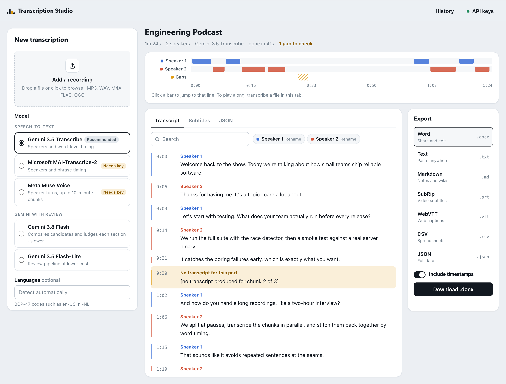

<div align="center">

# Transcription Agent

**Turn recordings into speaker-labeled, timestamped transcripts — with Gemini, Microsoft, or Meta.**

[](https://github.com/cyanxxy/transcription-agent-go/actions/workflows/ci.yml)
[](https://github.com/cyanxxy/transcription-agent-go/releases/latest)
[](go.mod)
[](LICENSE)



</div>

## Why

- **Who said what, and when.** Speaker labels and timestamps on every line, with a timeline you can click to play any moment.
- **Long recordings just work.** Audio is split at pauses, transcribed in parallel, and stitched back together without repeated text.
- **Export anywhere.** Word, Markdown, text, SRT, WebVTT, CSV, or JSON — rename speakers at export time.
- **Your choice of model.** Gemini 3.5 Transcribe by default, or Microsoft MAI-Transcribe-2, Meta Muse Voice, and Gemini Flash with a review judge.
- **Built to run.** A web app (Transcription Studio) and a single-binary CLI; jobs survive restarts; runs on Linux, macOS, Windows, and Docker.

## Quickstart

You need **Go 1.26+**, **FFmpeg**, and an API key for one provider.

```bash
git clone https://github.com/cyanxxy/transcription-agent-go.git
cd transcription-agent-go
make build
./bin/transcription-server --addr 127.0.0.1:8080
```

Open **http://localhost:8080**, click **API keys**, add a key, and drop in a recording.

<details>
<summary><b>Windows</b></summary>

```powershell
winget install GoLang.Go
winget install Gyan.FFmpeg
git clone https://github.com/cyanxxy/transcription-agent-go.git
cd transcription-agent-go
go build -o bin\transcription-server.exe .\cmd\server
go build -o bin\transcriber-cli.exe .\cmd\cli
.\bin\transcription-server.exe --addr 127.0.0.1:8080
```

Open a new terminal after installing so `ffmpeg` is on `PATH`.
</details>

<details>
<summary><b>Docker</b></summary>

```bash
make docker
docker run --rm -p 8080:8080 -e GEMINI_API_KEY transcription-agent:dev
```

Mount a volume at `/app/data/jobs` to keep jobs across restarts.
</details>

## API keys

Add keys in the web app (**API keys**, from the server's own machine), with the CLI, or through the environment. Environment variables win.

| Provider | Environment | CLI |
|---|---|---|
| Gemini | `GEMINI_API_KEY` | `transcriber-cli auth set gemini` |
| Microsoft | `AZURE_SPEECH_KEY`, `AZURE_SPEECH_ENDPOINT` | `transcriber-cli auth set microsoft` |
| Meta | `META_API_KEY` | `transcriber-cli auth set meta` |

Keys are stored on the server with owner-only permissions and never reach the browser.

## Models

| Model | Best for |
|---|---|
| `gemini-3.5-transcribe` | **Default.** Fast, accurate speech-to-text with word timing |
| `MAI-Transcribe-2` | Microsoft speech-to-text |
| `muse-voice-transcribe-1.0` | Meta speech-to-text |
| `gemini-3.8-flash` | Hard audio: compares candidates and judges each section |
| `gemini-3.5-flash-lite` | The same review pipeline at lower cost |

Speech models can also opt into the judge with **Double-check with a judge** (`--speech-review`).

## CLI

```bash
./bin/transcriber-cli auth set gemini
./bin/transcriber-cli -i interview.m4a -o interview.docx \
  --language-codes en-US --speakers "Alice,Bob"
```

The format follows the `-o` extension: `.txt` `.md` `.docx` `.srt` `.vtt` `.csv` `.json`. Run `./bin/transcriber-cli -h` for every option.

## HTTP API

```bash
# Start a job
curl -F audio=@meeting.m4a -F model_name=gemini-3.5-transcribe http://localhost:8080/api/jobs
# → {"job_id":"…"}

# Follow progress, then download
curl -N http://localhost:8080/api/jobs/<job_id>/stream
curl -OJ "http://localhost:8080/api/jobs/<job_id>/export?format=srt"
```

| Endpoint | |
|---|---|
| `POST /api/jobs` | Upload audio and start a job |
| `GET /api/jobs/{id}/stream` | Live progress (Server-Sent Events, resumable) |
| `GET /api/jobs/{id}/export` | Download as `txt`, `md`, `docx`, `srt`, `vtt`, `csv`, or `json` |
| `POST /api/jobs/{id}/cancel` · `/review` | Cancel, or accept/reject a flagged transcript |
| `GET /healthz` · `/readyz` | Health probes |

Form fields mirror the CLI: `language_codes`, `speakers`, `speech_review`, `remove_fillers`, `chunk_strategy`, and more.

## Configuration

Most settings have sensible defaults. The ones you'll likely touch:

| Flag | Env | Default |
|---|---|---|
| `--addr` | `HTTP_ADDR` | `:8080` |
| `--auth-token` | `API_AUTH_TOKEN` | none — set it when exposed beyond localhost |
| `--job-dir` | `JOB_DIR` | `./data/jobs` |
| `--job-ttl` | `JOB_TTL` | `30m` |
| `--max-concurrency` | `MAX_CONCURRENCY` | `4` |
| `--max-upload-bytes` | `MAX_UPLOAD_BYTES` | 200 MiB |

Run `./bin/transcription-server -h` for the full list.

## Deploying

The server ships with retries, durable jobs, graceful shutdown, structured logs, and strict security headers. Before going live:

- Set `API_AUTH_TOKEN` or put it behind an authenticating proxy — jobs spend your provider quota.
- Terminate TLS at a reverse proxy, and wire `/healthz` and `/readyz` to your orchestrator.
- Keep `JOB_DIR` on a persistent volume; recordings and transcripts are sensitive.

## Development

```bash
make test-race   # tests with the race detector
make lint        # golangci-lint
```

CI runs lint, vulnerability scanning, and the test suite on Linux and Windows. Code lives in `cmd/` (server, CLI) and `internal/` (workflow, providers, audio, exports).

## License

[Apache 2.0](LICENSE)
